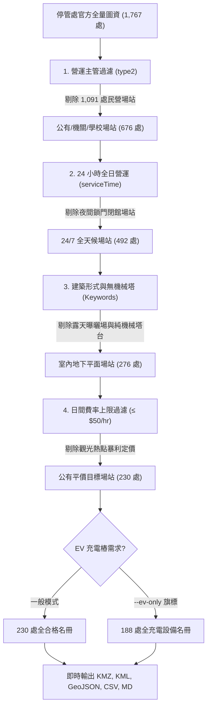

# 臺北市公有地下優質停車場圖資 (Taipei Parking Jäger)

本目錄為 **Parking Jäger 臺北市專屬模組**，包含專屬圖資串流生成程式、已生成之最新地圖圖層檔案，以及各行政區統一表格對照手冊。

本工具以「[格上-民有市場地下停車場](https://maps.app.goo.gl/WsLPEg952dXUfFgv5)」作為品質基準，向**臺北市停車管理工程處（停管處）官方單一真相來源（SSOT）**串流即時圖資，從全市登記之 1,767 處場站中，自動過濾出符合 **24小時營運、公有平價計時、全室內地下平面坡道、具備電動車充電樁** 之 230 處優質場站。

---

## 📥 最新產出檔案（即時下載與匯入）

| 格式 / 檔案名稱 | 適用生態系 / 導航軟體 | 特色與說明 |
| :--- | :--- | :--- |
| 📲 **[taipei_parking_lots.kmz](./taipei_parking_lots.kmz)** | **[CoMaps](https://github.com/comaps/comaps)** / **Organic Maps** | **【推薦】** 僅 32 KB！手機點擊即開，一鍵匯入 230 站離線書籤，內建專屬停車圖標與全離線導航 |
| 🌐 **[taipei_parking_lots.geojson](./taipei_parking_lots.geojson)** | **OpenStreetMap** / **uMap** / **GitHub** | 符合標準 OSM 標籤架構（`amenity=parking`），可用於 JOSM 編輯對齊或 GitHub 線上預覽 |
| 📍 **[taipei_parking_lots.kml](./taipei_parking_lots.kml)** | **Google 我的地圖 (My Maps)** | 內嵌氣泡資訊卡、自訂地圖圖標與 Google Maps 導航一鍵連結 |
| 📊 **[taipei_parking_lots.csv](./taipei_parking_lots.csv)** | **Excel** / **Google 試算表** | 帶有 UTF-8 BOM，包含官方車道入口精準經緯度與完整計費文字說明 |
| 📋 **[taipei_parking_lots.md](./taipei_parking_lots.md)** | **Markdown 文件** | 臺北市 12 行政區統一 7 欄位表格完整手冊（共 230 站） |

---

## 🗺️ 如何匯入 Google 我的地圖（Google My Maps 完整步驟指南）

產出之 [`taipei_parking_lots.kml`](./taipei_parking_lots.kml) 與 [`taipei_parking_lots.csv`](./taipei_parking_lots.csv) 專為 Google 地圖雲端圖資設計，支援電腦匯入並自動無縫同步至手機 Google Maps App：

### 電腦端匯入設定（只需 1 次）：
1. **開啟地圖編輯器**：使用瀏覽器登入 [Google 我的地圖 (My Maps)](https://mymaps.google.com/)（請確認登入欲使用的 Google 帳號）。
2. **建立新地圖**：點擊左上方「**+ 建立新地圖**」按鈕。
3. **一鍵匯入圖層**：
   - 於左側圖層面板找到「無標題圖層」，點擊下方的「**匯入** (Import)」。
   - 拖曳本目錄下的 [**`taipei_parking_lots.kml`**](./taipei_parking_lots.kml)（**推薦**，已內嵌專屬圖標與氣泡卡，無需手動對應欄位）。
   - *（若選擇上傳 CSV）*：選取座標欄位為「**緯度(Latitude)**」與「**經度(Longitude)**」，地標標題欄位選擇「**名稱**」。
4. **命名地圖**：點擊左上方「無標題地圖」，輸入自訂名稱（例如：`臺北市公有地下優質停車場`）。

### 手機端即時瀏覽與導航（iOS / Android 皆通用）：
1. 開啟手機上的 **Google 地圖 (Google Maps App)**。
2. 點擊底部導覽列的「**已儲存** (Saved)」。
3. 頁面往下滑至最底部，點選「**地圖** (Maps)」。
4. 點選剛剛建立的「**臺北市公有地下優質停車場**」，地圖即刻疊加所有篩選合格之藍色停車場圖釘。
5. **直接發起導航**：點擊地圖上的任一停車場圖釘，即可查看詳細日間費率、夜間優惠、限高、充電格數與電話，點擊「**路線**」按鈕即刻直接導航至車道入口！

---

## 📲 如何在 CoMaps / Organic Maps 中使用（100% 離線導航）

[CoMaps](https://github.com/comaps/comaps) 是 Organic Maps 的社群開源分支，完全基於 OpenStreetMap 圖資運作，注重隱私且支援完全無網路離線導航：

1. 手機下載安裝 **CoMaps**（或 Organic Maps，支援 iOS App Store / Google Play / F-Droid）。
2. 在手機上下載 [`taipei_parking_lots.kmz`](./taipei_parking_lots.kmz)。
3. 在檔案管理器、LINE、Telegram 或 AirDrop 中點擊該檔案，選擇**「以 CoMaps 開啟」**。
4. CoMaps 將自動匯入名為 **「臺北市公有地下優質停車場 (Taipei Parking Jäger)」** 的書籤群組，地圖上即時顯示藍色停車圖標，點選任何圖釘皆可直接離線規劃路線！

---

## 🗺️ 如何回饋與同步至 OpenStreetMap (OSM) 社群

CoMaps 的離線地圖底層全量取自 **OpenStreetMap (OSM)** 的每月資料擷取。本專案所產出之 [`taipei_parking_lots.geojson`](./taipei_parking_lots.geojson) 具備標準 OSM 標籤結構，可直接作為社群回饋與圖資驗證層：

### OSM 標籤對應標準：
* `amenity = parking`
* `parking = underground`（地下平面）或 `multi-storey`（立體共構）
* `access = yes`
* `fee = yes`
* `opening_hours = 24/7`
* `capacity = {小型車總數}`
* `capacity:charging = {充電樁數量}`
* `maxheight = {限高公尺數}`
* `charge = {小型車計時費率說明}`
* `operator = 臺北市停車管理工程處`
* `ref:tpe = {停管處官方場站代碼}`

> 💡 **OSM 編輯者指引**：在 [JOSM 編輯器](https://josm.openstreetmap.de/) 中開啟本 GeoJSON 圖層，即可與台北市現有 OSM 圖資比對，將缺漏的公有地下場站或電動車充電格數（`capacity:charging`）回饋提交給 OpenStreetMap。一旦合併入 OSM，全世界所有使用 CoMaps 的用戶在下個月的離線圖資更新中便能自動享有此資訊！

---

## ⚡ 快速執行 (CLI Quick Start)

本程式採用**純 Python 標準庫**撰寫，無任何第三方套件相依性（免 `pip install`）：

```bash
# 1. 預設模式：抓取官方最新數據，產出 230 處優質場站 (同時更新 KMZ, KML, GeoJSON, CSV, MD)
python Taipei/generate_parking_maps.py

# 2. 純電車模式：僅篩選具備 EV 充電樁格位之場站 (188 處)
python Taipei/generate_parking_maps.py --ev-only

# 3. 超平價模式：小型車日間費率限定每小時 40 元以下 (≤ 40 NTD/hr)
python Taipei/generate_parking_maps.py --max-rate 40

# 4. 指定行政區模式：例如僅輸出松山區的場站
python Taipei/generate_parking_maps.py --district 松山區

# 5. 強制不使用快取，直接向 Azure Blob 重新串流最新公告
python Taipei/generate_parking_maps.py --no-cache
```

---

## 🔍 六道篩選機制管線 (Filtering Pipeline)

停管處官方圖資（`TCMSV_alldesc.json`）收錄臺北市全區 1,767 處停車設施。為避開私人高價、機械塔樓、露天曝曬與夜間關門等問題，程式自動執行 6 關篩選：



---

## 🛠️ 命令列參數對照表 (CLI Options)

| 參數 | 型態 | 預設值 | 說明 |
| :--- | :--- | :--- | :--- |
| `--ev-only` | Flag | `False` | 僅篩選配備電動車充電樁（Charging Station）之場站 |
| `--max-rate <N>` | int | `50` | 設定日間每小時小型車最高收費上限（如設為 `40` 或 `30`） |
| `--district <名稱>`| str | `None` | 限定單一行政區，例如 `--district 大安區` 或 `--district 松山區` |
| `--no-cache` | Flag | `False` | 強制忽略本地快取，即時向停管處官方 Azure Blob 串流最新全量圖資 |
| `--cache-file <路徑>`| str | `alldesc_cache.json` | 指定官方原始圖資本地快取路徑（避免重覆下載 2.9MB 資料） |
| `--output-kmz <路徑>`| str | `taipei_parking_lots.kmz` | 指定產出 CoMaps / Organic Maps 專用 KMZ 壓縮檔路徑 |
| `--output-geojson <路徑>`| str | `taipei_parking_lots.geojson`| 指定產出 OpenStreetMap 標籤架構 GeoJSON 路徑 |
| `--output-kml <路徑>`| str | `taipei_parking_lots.kml` | 指定產出 Google My Maps KML 檔案路徑 |
| `--output-csv <路徑>`| str | `taipei_parking_lots.csv` | 指定產出 CSV 檔案路徑 |
| `--output-md <路徑>` | str | `taipei_parking_lots.md` | 指定產出各行政區統一結構 Markdown 表格手冊路徑 |

---

## 📡 臺北市單一真相來源 (SSOT Endpoint)

- **主管機關**：臺北市停車管理工程處（Taipei City Parking Management and Development Office）
- **官方 API 端點**：`https://tcgbusfs.blob.core.windows.net/blobtcmsv/TCMSV_alldesc.json`
- **授權條款**：政府資料開放授權條款（Open Government Data License）
