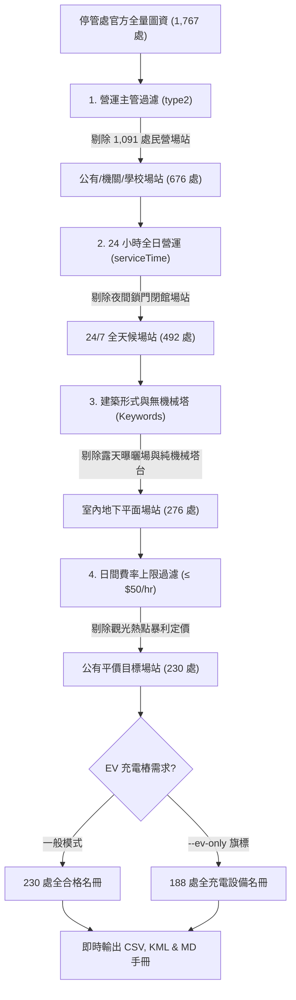

# 臺北市公有地下優質停車場圖資 (Taipei Parking Jäger)

本目錄為 **Parking Jäger 臺北市專屬模組**，包含專屬圖資串流生成程式、已生成之最新地圖圖層檔案，以及各行政區統一表格對照手冊。

本工具以「[格上-民有市場地下停車場](https://maps.app.goo.gl/WsLPEg952dXUfFgv5)」作為品質基準，向**臺北市停車管理工程處（停管處）官方單一真相來源（SSOT）**串流即時圖資，從全市登記之 1,767 處場站中，自動過濾出符合 **24小時營運、公有平價計時、全室內地下平面坡道、具備電動車充電樁** 之 230 處優質場站。

---

## 📥 最新產出檔案（即時下載與匯入）

* 📥 **地圖圖層匯入檔案（可直接匯入至個人 Google 地圖帳號）**：
  * **KML 圖資檔**：[taipei_parking_lots.kml](./taipei_parking_lots.kml)（含藍色專屬地圖圖標、氣泡卡與 Google Maps 導航連結）
  * **CSV 資料表**：[taipei_parking_lots.csv](./taipei_parking_lots.csv)（UTF-8 with BOM，Excel / Google 試算表相容不亂碼）
  * **Markdown 表格手冊**：[taipei_parking_lots.md](./taipei_parking_lots.md)（臺北市 12 行政區統一 7 欄位完整對照手冊，共 230 站）

---

## ⚡ 快速執行 (CLI Quick Start)

本程式採用**純 Python 標準庫**撰寫，無任何第三方套件相依性（免 `pip install`）：

```bash
# 1. 預設模式：抓取官方最新數據，產出 230 處優質場站 (同時更新 CSV, KML, MD)
python Taipei/generate_parking_maps.py

# 2. 純電車模式：僅篩選具備 EV 充電樁格位之場站 (188 處)
python Taipei/generate_parking_maps.py --ev-only

# 3. 超平價模式：小型車日間費率限定每小時 40 元以下 (≤ 40 NTD/hr)
python Taipei/generate_parking_maps.py --max-rate 40

# 4. 指定行政區模式：例如僅輸出松山區的場站
python Taipei/generate_parking_maps.py --district 松山區

# 5. 強制不使用快取，直接向 Azure Blob 重新串流最新公告
python Taipei/generate_parking_maps.py --no-cache
```

---

## 🔍 六道篩選機制管線 (Filtering Pipeline)

停管處官方圖資（`TCMSV_alldesc.json`）收錄臺北市全區 1,767 處停車設施。為避開私人高價、機械塔樓、露天曝曬與夜間關門等問題，程式自動執行 6 關篩選：



### 篩選依據說明：

| 篩選關卡 | 判定依據 | 篩除標的 | 保留效益 |
| :--- | :--- | :--- | :--- |
| **1. 營運主管主體** | 欄位 `type2` 僅保留公有、委外及公立機關學校 | 剔除 1,091 處純「民營停車場」 | 避免私人業者動輒 100~150 元/時之暴利定價與複雜陷阱條款 |
| **2. 24小時營業** | 欄位 `serviceTime` 需符合 `00:00:00-23:59:59` 或含 `24小時` | 剔除夜間 22:00 關閉閘門拉鐵捲門之辦公大樓或學校 | 確保任何時段進出場皆暢行無阻，不被鎖車 |
| **3. 地下全平面結構** | 地址/名稱含 `地下`、`B1`、`B2`、`室內`，並排除 `機械塔`、`倉儲式`、`雙層機械` | 剔除露天碎石日曬場與限高低於 1.7m 之機械塔樓 | 避開暴雨日曬，且休旅車 SUV / 純電車不用擔心底盤刮傷或超重超高 |
| **4. 公有平價天花板** | 解析 `FareInfo` 及 `payex` 計時收費，日間上限 $\le 50$ 元/時 | 剔除每小時收費 80~100 元以上之極端高價站點 | 鎖定 30~40 元/時平價公有收費，夜間更享有 10 元/時超值優惠 |
| **5. 電動車充電友善** | 檢驗 `ChargingStation > 0` 或設施備註含充電樁 | 依 `--ev-only` 參數自由開關 | 提供 188 處具備 AC/DC 充電樁之友善補電車位 |
| **6. 車道入口精準導航** | 提取 `EntranceCoord`（WGS84 經緯度） | 排除無座標場站，校驗台北經緯度邊界 | 直接引導車輛開抵**車道進場坡道閘門**，而非寬廣公園或地號中央 |

---

## 🛠️ 命令列參數對照表 (CLI Options)

| 參數 | 型態 | 預設值 | 說明 |
| :--- | :--- | :--- | :--- |
| `--ev-only` | Flag | `False` | 僅篩選配備電動車充電樁（Charging Station）之場站 |
| `--max-rate <N>` | int | `50` | 設定日間每小時小型車最高收費上限（如設為 `40` 或 `30`） |
| `--district <名稱>`| str | `None` | 限定單一行政區，例如 `--district 大安區` 或 `--district 松山區` |
| `--no-cache` | Flag | `False` | 強制忽略本地快取，即時向停管處官方 Azure Blob 串流最新全量圖資 |
| `--cache-file <路徑>`| str | `alldesc_cache.json` | 指定官方原始圖資本地快取路徑（避免重覆下載 2.9MB 資料） |
| `--output-csv <路徑>`| str | `taipei_parking_lots.csv` | 指定產出 CSV 檔案路徑 |
| `--output-kml <路徑>`| str | `taipei_parking_lots.kml` | 指定產出 Google My Maps KML 檔案路徑 |
| `--output-md <路徑>` | str | `taipei_parking_lots.md` | 指定產出各行政區統一結構 Markdown 表格手冊路徑 |

---

## 🗺️ 匯入 Google 我的地圖（Google My Maps）指引

1. 使用瀏覽器登入 [Google 我的地圖 (My Maps)](https://mymaps.google.com/)。
2. 點擊「**+ 建立新地圖**」。
3. 點擊圖層底下的「**匯入** (Import)」，拖曳 [`taipei_parking_lots.kml`](./taipei_parking_lots.kml) 或 [`taipei_parking_lots.csv`](./taipei_parking_lots.csv)。
4. 開啟手機 **Google 地圖 (Google Maps App)** $\to$「**已儲存**」$\to$「**地圖**」即可開啟本圖層，點擊任一圖釘即可一鍵直接導航至停車場入口！

---

## 📡 臺北市單一真相來源 (SSOT Endpoint)

- **主管機關**：臺北市停車管理工程處（Taipei City Parking Management and Development Office）
- **官方 API 端點**：`https://tcgbusfs.blob.core.windows.net/blobtcmsv/TCMSV_alldesc.json`
- **授權條款**：政府資料開放授權條款（Open Government Data License）

